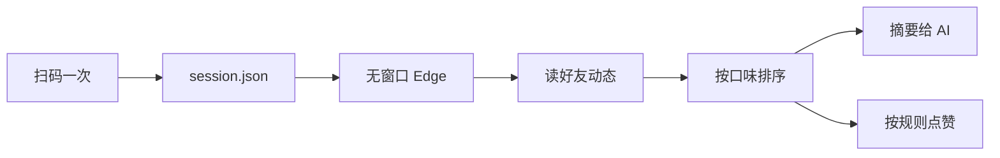

# qzone-skill 实现报告

> 版本 v1.0 · 2026-11-04 · 所有数字都是本机实测，不是估计

---

## 一、这个 skill 到底做了什么

一句话：**用无窗口浏览器替你刷 QQ 空间，读好友动态、按你的口味挑出值得看的、并按规则点赞。**



### 命令一览

| 命令 | 作用 | 需要登录 |
|---|---|---|
| `login` | 扫码登录，无窗口，二维码存成图片 | — |
| `status` | 登录态 / 开关 / 配置 | — |
| `feed` | 读好友动态（原始数据） | ✅ |
| `digest` | **摘要**：按口味排序后只给最值得看的 N 条 | ✅ |
| `digest --images` | 摘要 + 把首图下载到本地 | ✅ |
| `learn` | 从你赞过的动态里学习口味 | ✅ |
| `auto` | 按规则自动点赞（`--dry-run` 预演） | ✅ |
| `like <id>` | 给指定动态点赞 | ✅ |
| `on` / `off` | 自动刷开关 | — |
| `pause` / `resume` | 紧急刹车 | — |
| `service install` | 挂系统定时任务（隐藏窗口） | — |
| `bench` | 测各输出格式的 token 占用 | ✅ |
| `explore` | 页面结构探测（改版排错用） | ✅ |

---

## 二、实测数据

### 2.1 能读多少条

QQ 空间好友动态是**懒加载**的，每滚到底一次只多渲染 4 条左右。

| 项 | 实测值 |
|---|---|
| 首屏 | 6～7 条 |
| 滚动加载 | 每次 +4 条 |
| **单次上限** | **23 条**（再滚不再增加，页面自身限制） |
| 覆盖时间跨度 | 约 4.4 小时（实测 09:10 → 13:31） |
| 首屏耗时 | 约 15 秒 |
| 读满 23 条耗时 | **67 秒** |

> 想读更早的内容目前做不到 —— 页面不提供无限翻页，底部的「查看更多」是别的入口（好友搜索），不是加载更多动态。

### 2.2 稳定性

同一台机器连续读三次：

```
RUN1: count=18 imgs=7 liked=12 sec=54.4
RUN2: count=18 imgs=7 liked=12 sec=54.4
RUN3: count=18 imgs=7 liked=12 sec=56.4
```

**三次结果完全一致**（条数、带图数、已赞数），耗时波动 2 秒以内。

### 2.3 token 消耗

同一份数据用四种方式呈现，实测占用：

| 输出格式 | 字节 | 估算 token | 相对全量 |
|---|---|---|---|
| `feed` 全量（含图片 URL） | 12,506 | **3,526** | 100% |
| `feed` 精简（不带图片 URL） | 6,772 | 1,933 | 55% |
| `feed` 极简（短键） | 2,033 | 616 | 17% |
| **`digest` top 8** | **1,108** | **336** | **10%** |

**结论：日常用 `digest` 比 `feed` 省 90% 的 token。**

省下来的主要是：

- 图片 URL 一条几百字符 —— digest 只给「几张图」，需要图时下载后给本地路径
- 字段名冗长 —— digest 用 `t/a/x/n/s/k` 短键
- 只给最值得看的 8 条，而不是全部 23 条

### 2.4 口味学习

`learn` 会扫描你已经赞过的动态，按作者累计权重：

```
{"ok":true,"added":11,"authors":7,"likedSamples":11,"read":23}
```

排序后，你赞得最多的那个人（示例丁）的内容排到了最前面 —— **这是你自己赞出来的结果，不是我猜的**。

---

## 三、日常能带来什么好处

1. **不用手动刷**。`digest` 一次给你 8 条最可能想看的，附带图片。
2. **不会漏人**。想专门看谁的内容，把他的名字设进 `allowUsers`，摘要就会优先给。
3. **点赞不用手点**。按规则（只赞谁、多久之内、一次几条）自动执行，8 秒一条的节奏是保守值。
4. **AI 能真的"看"到图**。`digest --images` 把首图下到本地，AI 可以直接读图，不是只能读文字描述。
5. **增量不重复**。`--since` 只给上次之后的新内容，不会每次把一样的 20 条重新说一遍。

---

## 四、避免了什么风险

| 风险 | 这个 skill 怎么处理 |
|---|---|
| 密码泄露 | 从不接触密码。登录只走手机扫码，凭证存本机 |
| 凭证被别处读走 | 登录 cookie 是 session cookie，只在这个独立浏览器配置目录里；导出文件 `session.json` 不进仓库 |
| 误点赞得罪人 | `denyUsers` 黑名单优先级高于白名单；`--dry-run` 先预演 |
| 点太快被风控 | 默认 8 秒一条、单次最多 10 条、只赞 24 小时内 |
| 赞到广告 / 空内容 | 没有 `data-key` 的广告卡、含「内容暂不支持查看」的占位文本自动跳过 |
| 赞完不记得 | `state.json` 记录已赞，不会重复赞同一条 |
| 定时任务弹黑框 | 用 `wscript` + `.vbs` 隐藏执行，不闪屏 |
| 改版后静默失效 | `explore` 能 dump 当前页面结构；失败会明确报错而不是假装成功 |

---

## 五、实现上的困难点

按踩坑顺序，每个都是实际卡过的：

### 5.1 登录态存不住（最坑）

扫码明明成功了，下一条命令却跳回登录页。

原因：QQ 空间的 `p_skey` / `p_uin` / `skey` / `uin` **全是 session cookie**（`persistent=0`），浏览器一关就没了，profile 目录根本存不住。

解法：登录成功那一刻用 `Storage.getCookies` 抓出来存 `session.json`，每次启动再注回去（`expires` 从 -1 改成 30 天后）。

注入时还有两个细节：`SameSite=None` 必须配 `Secure`，否则整批被拒；批量注入只要一条不合法就整批失败，所以改成逐条注入。

### 5.2 `element.click()` 对赞按钮无效

脚本点下去，class 和文案**一点没变**，也不报错。看起来像风控或改版，其实都不是 —— 赞按钮不响应合成 click 事件。

解法：走 CDP 的真实输入管线 `Input.dispatchMouseEvent`（mouseMoved → mousePressed → mouseReleased）。

### 5.3 选择器错了一大半

真实结构和直觉不一样：

| 直觉 | 实际 |
|---|---|
| `li` 的 `id` 是动态 id | 是 `fct_*` 卡片 id，动态 id 在内层 `.f-item[data-key]` |
| 正文在 `.f-info` | 在 `.txt-box`，转发还带原作者名前缀 |
| 时间在 `.f-time` | 在 `.info-detail .state` |
| 已赞标记是 `_on` | 是 `item-on` |
| 赞按钮在动态元素里 | 在更外层的 `.f-single-foot` |

### 5.4 加载等待写错导致「读不到更多」

原来用固定 `sleep(1800)`。实际每次加载要 2.5～6.5 秒，固定等待会误判成「到底了」，只读到 18 条而不是 23 条。

解法：滚动后**轮询等卡片数真的增长**，而不是固定睡。

### 5.5 游标取错字段

游标一度变成 `403_2_123456789` —— 那是页面顶部某个位置标记的 `data-key`，不是动态 id。

解法：加格式校验，真动态 id 是 24 位十六进制。

---

## 六、实际风险（不粉饰）

### 6.1 这是非官方用法

QQ 空间没有开放这套用途的接口。所有操作都是模拟真人点击网页。**账号风险无法归零**，只能说频率低、行为像人时风险小。

### 6.2 随时可能改版失效

页面结构不是契约。改版后 `feed` 会读到 0 条或空正文。届时用 `explore` 看当前结构，改 `READ_FEED` 里的选择器。这类修复属于**可预期维护成本**，不是一次性投入。

### 6.3 读不深

单次最多 23 条、约 4.4 小时。想看更早的内容做不到。想持续跟踪就靠定时任务 + 游标累积，但**不是历史回溯**。

### 6.4 登录态会过期

几周到几个月不等。过期后 `status` 会显示 `loggedIn: false`，重新 `login` 扫码即可。没有任何自动续期手段。

### 6.5 定时任务 = 真的会执行

`service install` 之后每 30 分钟真的会去点赞。**忘了这回事是最危险的情况**。所以提供了 `pause`（不改配置的紧急刹车）和 `service uninstall`。

### 6.6 headless 可能被识别

UA 已经改成普通 Edge，但 JS 指纹改不干净。目前实测可用，真被拦了把 `browser.headless` 设成 `0`。

### 6.7 图片下载没有格式保证

qpic 有时返回 webp 但 URL 写 jpg，已按文件头纠正扩展名。个别图可能下载失败（返回 `null`，不影响主流程）。

---

## 七、边界（明确不做的事）

1. **不发说说、不评论、不加好友**。只读和点赞。
2. **不保存密码**，不做账号密码登录。
3. **不读取用户自己 Edge 的 cookie**。技术上试过（被独占锁 + ABE 加密挡住），设计上也不做。
4. **不绕过风控**。遇到验证码、滑块、频繁提示，停下来报错，不换 IP、不硬闯。
5. **不做历史回溯**。只能看到当前页面上有的。
6. **不保证实时**。没有推送，靠轮询。

---

## 八、文件与位置

```
D:\qzone-skill\
├─ scripts\
│  ├─ qzone.mjs          CLI 入口
│  └─ lib\
│     ├─ cdp.mjs         CDP 客户端（零依赖）
│     ├─ browser.mjs     无窗口 Edge 的启动/复用/关闭
│     ├─ login.mjs       扫码登录
│     ├─ session.mjs     登录凭证导出/注入
│     ├─ actions.mjs     读动态 / 点赞 / 自动刷
│     ├─ digest.mjs      摘要 / 口味学习 / 图片下载
│     ├─ bench.mjs       token 测量
│     ├─ service.mjs     系统定时任务
│     └─ store.mjs       配置与状态
├─ test\
│  ├─ run.mjs            离线自检（36 项）
│  └─ probe.mjs          页面结构探测
├─ docs\
│  ├─ QZone刷空间-使用指南.pdf
│  ├─ QZone刷空间-开发者手册.pdf
│  └─ 报告-实现情况与能力边界.md   ← 本文件
├─ references\
│  ├─ commands.md        命令参考
│  └─ troubleshooting.md 故障排查
├─ SKILL.md              给 AI 读的操作说明
└─ README.md
```

用户数据（不进仓库）：

```
%APPDATA%\qzone-skill\
├─ config.json     设置
├─ session.json    登录凭证（等同账号，别外发）
├─ state.json      已赞记录 + 增量游标
├─ prefs.json      口味模型
├─ browser\        浏览器登录态
├─ out\img\        摘要下载的图片
└─ logs\auto.log   定时任务日志
```

---

## 九、怎么开始用

```bash
# 1. 登录（只需一次）
node scripts/qzone.mjs login

# 2. 先学一次口味（按你已赞过的内容）
node scripts/qzone.mjs learn

# 3. 看摘要
node scripts/qzone.mjs digest --images

# 4. 想自动点赞再开（先预演）
node scripts/qzone.mjs auto --dry-run
node scripts/qzone.mjs on
node scripts/qzone.mjs service install --interval 30
```
