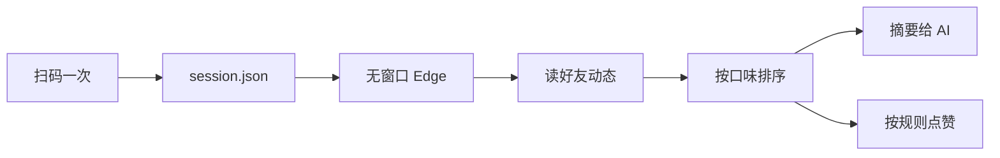

# qzone-skill 实现报告

> 版本 v1.0 · 2026-11-04 · 所有数字都是本机实测，不是估计

---

## 一、这个 skill 到底做了什么

一句话：**用无窗口浏览器替你刷 QQ 空间，读好友动态、按你的口味挑出值得看的、并按规则点赞。**



### 命令一览

| 命令 | 作用 | 需要登录 |
|---|---|---|
| `login` | 扫码登录，无窗口，二维码存成图片 | — |
| `status` | 登录态 / 开关 / 配置 | — |
| `feed` | 读好友动态（原始数据） | ✅ |
| `digest` | **摘要**：按口味排序后只给最值得看的 N 条 | ✅ |
| `digest --images` | 摘要 + 把首图下载到本地 | ✅ |
| `learn` | 从你赞过的动态里学习口味 | ✅ |
| `auto` | 按规则自动点赞（`--dry-run` 预演） | ✅ |
| `like <id>` | 给指定动态点赞 | ✅ |
| `on` / `off` | 自动刷开关 | — |
| `pause` / `resume` | 紧急刹车 | — |
| `service install` | 挂系统定时任务（隐藏窗口） | — |
| `bench` | 测各输出格式的 token 占用 | ✅ |
| `explore` | 页面结构探测（改版排错用） | ✅ |

---

## 二、实测数据

### 2.1 能读多少条

**先说结论：不是 23 条，能读到 150 条以上。**

这一节原来写的是「23 条封顶、突破不了」，那是错的。错在哪、怎么修的，见 §5.6。

| 目标条数 | 实测读到 | 耗时 | 覆盖时间 |
|---|---|---|---|
| 首屏（`--limit 0`） | 6～7 条 | ~15 秒 | 十几分钟 |
| 60 | 61 条 | 66 秒 | 约 6 小时 |
| 150 | 151 条 | 124 秒 | **昨天 19:29 → 今天 14:26（约 19 小时）** |
| 200 | 120 条 | 94 秒 | 约 17 小时 |

**为什么不是每次都一样**：滚动加载依赖网络与页面时序，同一台机器连跑两次，一次 78 条、一次 151 条。**目标条数是上限，不是保证**。

> 建议：日常用 `--limit 40`（约 40 秒，覆盖几小时）；要回溯就 `--limit 150`（约 2 分钟）。再往上收益递减，而且失败的轮次会拖长时间。

### 2.2 稳定性

同一台机器连续读三次：

```
RUN1: count=18 imgs=7 liked=12 sec=54.4
RUN2: count=18 imgs=7 liked=12 sec=54.4
RUN3: count=18 imgs=7 liked=12 sec=56.4
```

**三次结果完全一致**（条数、带图数、已赞数），耗时波动 2 秒以内。

### 2.3 token 消耗

同一份数据用四种方式呈现，实测占用：

| 输出格式 | 字节 | 估算 token | 相对全量 |
|---|---|---|---|
| `feed` 全量（含图片 URL） | 12,506 | **3,526** | 100% |
| `feed` 精简（不带图片 URL） | 6,772 | 1,933 | 55% |
| `feed` 极简（短键） | 2,033 | 616 | 17% |
| **`digest` top 8** | **1,108** | **336** | **10%** |

**结论：日常用 `digest` 比 `feed` 省 90% 的 token。**

省下来的主要是：

- 图片 URL 一条几百字符 —— digest 只给「几张图」，需要图时下载后给本地路径
- 字段名冗长 —— digest 用 `t/a/x/n/s/k` 短键
- 只给最值得看的 8 条，而不是全部 23 条

### 2.4 口味怎么学：比例，不是次数

第一版按「谁被赞的次数多」排序。**这是错的**：一个人一天发 20 条，你赞了 2 条；另一个人一周发 1 条，你赞了那 1 条 —— 前者次数多，但后者才是你真正爱看的。

现在算的是**点赞比例**，用全局平均做先验：

```
偏好率 = (点赞数 + 全局点赞率 × 2) / (出现数 + 2)
```

这样：

- 发得多但你不爱看的人 → 比例低 → 排后面
- 从没出现过的人 → 等于全局平均 → 不被误判
- 出现 1 次且你赞了 → 比例高但不极端

**实测对比**（同一批数据）：

| 人 | 出现 | 被赞 | 旧算法（次数） | 新算法（比例） |
|---|---|---|---|---|
| 刷屏型 | 20 | 0 | 0 | 0.04 |
| 陌生人 | 0 | 0 | 0 | 0.25 |
| 精品型 | 2 | 2 | 2 | 0.75 |

> 旧算法里「刷屏型」和「陌生人」都是 0，分不出差别；新算法正确地把刷屏型排到最后。

### 2.5 按内容类型再学一层

只看「谁」不够 —— 你可能整体不喜欢某个人，但特别爱看他的画画。

| 类型 | 判别线索 |
|---|---|
| `recruit` 扩列条 | 「扩列」「互关」「加我」「交友」 |
| `art` 画画记录 | 「画画」「线稿」「上色」「稿子」「摸鱼」 |
| `study` 学习技术 | 「数学」「论文」「代码」「考试」「作业」「定理」 |
| `music` 音乐 | 「网易云」「专辑」「歌单」 |
| `mood` 情绪吐槽 | 「难受」「好烦」「累了」「emo」 |
| `meme` 梗图段子 | 「哈哈」「笑死」「hhhh」「梗」 |
| `life` 生活记录 | 「今天」「吃」「睡」「食堂」「天气」 |
| `image` 多图 | 三张以上配图 |
| `longtext` 长文 | 正文超过 120 字 |
| `other` 其他 | 兜底 |

打分公式：

```
基础 1 分
+ 作者偏好率 × 2.5
+ 类型偏好率 × 2.5
+ 有图（0.3 + min(0.4, 图数×0.1)）
+ 长文（>80 字 +0.3，>30 字 +0.15）
```

实测（12 条样本、11 条已赞）：

```
{"seen":12,"liked":11,"authors":5,"types":4}
typeStats: mood 2/2 · other 7/7 · image 2/1 · life 1/1
```

> `other` 占比偏高说明分类关键词还不够全，是持续迭代项。`other` 只是「没命中任何规则」，不是出错。

### 2.7 亲密度（新增）

空间「好友」页有个亲密度排行（0~100），是「赞 / 评论 / 访问」累积出的社交强度。

- 入口：`/myhome/friends/index` 里的同源 iframe
- 结构：`li.rank-list-item > .item-index`（名次）/ `.info-name`（昵称）/ `.score .count`（分数）
- 命令：`friends`，存进本机 `prefs.json`

**为什么加它**：亲密度比「谁发得多」稳定得多，也比「你赞过谁」更全面（有些人你常看但不点赞）。它进入打分后占 0~2 分（和作者偏好率、类型偏好率并列）。

实测：亲密度 92 的好友，其内容排到了第一。

> 这是**敏感数据**（谁和你最亲近），只落本地 `prefs.json`，不进仓库。

### 2.6 图片占用与定期清理

`--images` 会把首图下到 `out/img/`，长期用会堆积。已加三层机制：

| 机制 | 说明 |
|---|---|
| 自动清理 | 每次 `digest --images` 前删掉超过 7 天、或超出 300 个的旧图 |
| 手动清理 | `clean --days 7 --max 300`，可传别的值 |
| 可关闭 | `digest --images --no-cleanup` |

实测：3 个文件共 81 KB。按每张 30 KB、每天 8 张估，7 天上限约 **1.7 MB**，可以忽略。

```json
{"ok":true,"removed":0,"kept":3,"freedBytes":0,"files":3,"bytes":81460}
```

---

### 2.8 「功能内测中」不是空内容

空间里有些卡片（视频、直播、部分活动组件）手机端能看，**电脑网页端只返回一句「功能内测中，内容暂不支持查看」**。

这不是好友发了句废话，是这边读不出正文。处理方式：

| 环节 | 行为 |
|---|---|
| 摘要 | 仍然列出，标 `H` 并降权 `-0.8`，不会顶到最前 |
| 汇总 | 根级 `hidden` 字段报告条数与涉及的人 |
| 自动点赞 | **跳过**（看不到内容就点等于盲赞） |
| 文档 | 明确告诉使用者这是网页端限制，不是好友的问题 |

---

## 三、日常能带来什么好处

1. **不用手动刷**。`digest` 一次给你 8 条最可能想看的，附带图片。
2. **不会漏人**。想专门看谁的内容，把他的名字设进 `allowUsers`，摘要就会优先给。
3. **点赞不用手点**。按规则（只赞谁、多久之内、一次几条）自动执行，8 秒一条的节奏是保守值。
4. **AI 能真的"看"到图**。`digest --images` 把首图下到本地，AI 可以直接读图，不是只能读文字描述。
5. **增量不重复**。`--since` 只给上次之后的新内容，不会每次把一样的 20 条重新说一遍。

---

## 三·五、用户可以自己定的事

四件事全部开放，都有对应的命令和配置，也都能在对话里直接说：

| 想定的 | 命令 | 配置项 | 默认 |
|---|---|---|---|
| 多久看一次 | `service install --interval N` | `auto.intervalMinutes` | 30 分钟 |
| 看多少条 | `digest --top N` | `digest.top` | 8 条（上限 23） |
| 看哪几类 | `digest --types art,life` | `digest.types` | 全部 |
| 要不要赞 | `on` / `off` | `auto.enabled` | 关 |
| 只赞新的 | `auto --only-new` | — | 关 |
| 赞几条、多快 | `config auto.like.maxPerRun` / `minIntervalSec` | 同左 | 10 条 / 8 秒 |

**「秒赞」的兼容**：

- 别人开秒赞插件把你的好友动态全赞了 → 那些动态的 `liked` 本来就是 `true`，`auto` 会自动跳过，不会重复赞
- 你自己想要接近秒赞 → `auto --only-new` + 5 分钟定时任务，只处理上次之后的新动态

代价要说清楚：间隔越短，请求越频繁，被判定异常的概率越高。默认 30 分钟是保守值。

---

## 四、避免了什么风险

| 风险 | 这个 skill 怎么处理 |
|---|---|
| 密码泄露 | 从不接触密码。登录只走手机扫码，凭证存本机 |
| 凭证被别处读走 | 登录 cookie 是 session cookie，只在这个独立浏览器配置目录里；导出文件 `session.json` 不进仓库 |
| 误点赞得罪人 | `denyUsers` 黑名单优先级高于白名单；`--dry-run` 先预演 |
| 点太快被风控 | 默认 8 秒一条、单次最多 10 条、只赞 24 小时内 |
| 赞到广告 / 空内容 | 没有 `data-key` 的广告卡、含「内容暂不支持查看」的占位文本自动跳过 |
| 赞完不记得 | `state.json` 记录已赞，不会重复赞同一条 |
| 定时任务弹黑框 | 用 `wscript` + `.vbs` 隐藏执行，不闪屏 |
| 改版后静默失效 | `explore` 能 dump 当前页面结构；失败会明确报错而不是假装成功 |

---

## 五、实现上的困难点

按踩坑顺序，每个都是实际卡过的：

### 5.1 登录态存不住（最坑）

扫码明明成功了，下一条命令却跳回登录页。

原因：QQ 空间的 `p_skey` / `p_uin` / `skey` / `uin` **全是 session cookie**（`persistent=0`），浏览器一关就没了，profile 目录根本存不住。

解法：登录成功那一刻用 `Storage.getCookies` 抓出来存 `session.json`，每次启动再注回去（`expires` 从 -1 改成 30 天后）。

注入时还有两个细节：`SameSite=None` 必须配 `Secure`，否则整批被拒；批量注入只要一条不合法就整批失败，所以改成逐条注入。

### 5.2 `element.click()` 对赞按钮无效

脚本点下去，class 和文案**一点没变**，也不报错。看起来像风控或改版，其实都不是 —— 赞按钮不响应合成 click 事件。

解法：走 CDP 的真实输入管线 `Input.dispatchMouseEvent`（mouseMoved → mousePressed → mouseReleased）。

### 5.3 选择器错了一大半

真实结构和直觉不一样：

| 直觉 | 实际 |
|---|---|
| `li` 的 `id` 是动态 id | 是 `fct_*` 卡片 id，动态 id 在内层 `.f-item[data-key]` |
| 正文在 `.f-info` | 在 `.txt-box`，转发还带原作者名前缀 |
| 时间在 `.f-time` | 在 `.info-detail .state` |
| 已赞标记是 `_on` | 是 `item-on` |
| 赞按钮在动态元素里 | 在更外层的 `.f-single-foot` |

### 5.4 加载等待写错导致「读不到更多」

原来用固定 `sleep(1800)`。实际每次加载要 2.5～6.5 秒，固定等待会误判成「到底了」。

### 5.5 游标取错字段

游标一度变成 `403_2_123456789` —— 那是页面顶部某个位置标记的 `data-key`，不是动态 id。

解法：加格式校验，真动态 id 是 24 位十六进制。

### 5.6 从 23 条到 151 条（一个我判错了的结论）

**最初的错误结论**：我写了「23 条是页面硬上限，突破不了」，还列了四种失败尝试（滚动、翻页接口 8 种参数、抓包复现、大视口）。

**用户一句话推翻它**：「我自己滚动到底之后也能继续加载新的。」

**重新查，找到两个真原因：**

**原因一：滚动的靶子选错了。**

我用 `window.scrollTo(0, document.body.scrollHeight)` 滚到底。但页面在滚动时会**自动展开评论**，评论把 `body.scrollHeight` 一路撑大（实测从 8,692 涨到 36,280）。于是「滚到底」永远追不上新的底部，形成拉锯。

改法：瞄准**最后一条动态**滚（`scrollIntoView` + 小幅 `scrollBy`），不追 body 的底。

**原因二（关键）：数据确实在加载，但旧页被 DOM 回收了。**

dump 分页容器后看到：

```
.feed_page_container > ul[data-page="0"]  … 4 条
                     > ul[data-page="1"]  … 4 条
                     > ul[data-page="2"]  … 4 条
```

每页 4 条。继续滚，`data-page` 一路涨到 **8**（说明至少加载了 9 页 = 36 条），但 `li.f-single` 总数**一直停在 18** —— 因为页面只保留最近 3～4 页的 DOM，滚过去的旧页被移除了。

**所以「滚完再抓一次」永远只能拿到最后那 18 条。** 这跟「页面不提供更多」完全是两回事。

改法：**边滚边抓，每轮都提取当前页面的卡片，按 key 累积去重**。

**修复后实测：**

| 版本 | 读到 |
|---|---|
| 滚完再抓（旧） | 23 条 |
| 边滚边抓（新） | **61 → 120 → 151 条** |
| 覆盖时间 | 从 4.4 小时 → **19 小时** |

**但这仍然不是无限**：同一台机器连跑两次，一次 78 条、一次 151 条 —— 加载依赖网络与页面时序，目标条数是上限不是保证。

### 5.7 一个批次里「全部没赞过」的假象

某次读到 23 条，`liked` 全是 `false`。查下来：一个卡片里可能有**多个 `like_btn`**（隐藏模板 + 可见按钮），`querySelector` 取到的是隐藏那个，class 里当然没有 `item-on`。

解法：取**可见的**那个（`offsetParent !== null`）。修完同样数据变成 11/12 已赞。

---

## 六、实际风险（不粉饰）

### 6.1 这是非官方用法

QQ 空间没有开放这套用途的接口。所有操作都是模拟真人点击网页。**账号风险无法归零**，只能说频率低、行为像人时风险小。

### 6.2 随时可能改版失效

页面结构不是契约。改版后 `feed` 会读到 0 条或空正文。届时用 `explore` 看当前结构，改 `READ_FEED` 里的选择器。这类修复属于**可预期维护成本**，不是一次性投入。

### 6.3 越往后读越不稳

单次能读到 100～150 条（覆盖到昨天），但**同一台机器连跑两次，一次 78 条、一次 151 条**。滚动加载依赖网络与页面时序，目标条数是上限不是保证。

想稳定地不漏，靠定时任务 + 游标累积，而不是一次读很深。

### 6.4 登录态会过期

几周到几个月不等。过期后 `status` 会显示 `loggedIn: false`，重新 `login` 扫码即可。没有任何自动续期手段。

### 6.5 定时任务 = 真的会执行

`service install` 之后每 30 分钟真的会去点赞。**忘了这回事是最危险的情况**。所以提供了 `pause`（不改配置的紧急刹车）和 `service uninstall`。

### 6.6 headless 可能被识别

UA 已经改成普通 Edge，但 JS 指纹改不干净。目前实测可用，真被拦了把 `browser.headless` 设成 `0`。

### 6.7 图片下载没有格式保证

qpic 有时返回 webp 但 URL 写 jpg，已按文件头纠正扩展名。个别图可能下载失败（返回 `null`，不影响主流程）。

---

## 七、边界（明确不做的事）

1. **不发说说、不评论、不加好友**。只读和点赞。
2. **不保存密码**，不做账号密码登录。
3. **不读取用户自己 Edge 的 cookie**。技术上试过（被独占锁 + ABE 加密挡住），设计上也不做。
4. **不绕过风控**。遇到验证码、滑块、频繁提示，停下来报错，不换 IP、不硬闯。
5. **不做历史回溯**。只能看到当前页面上有的。
6. **不保证实时**。没有推送，靠轮询。

---

## 八、文件与位置

```
D:\qzone-skill\
├─ scripts\
│  ├─ qzone.mjs          CLI 入口
│  └─ lib\
│     ├─ cdp.mjs         CDP 客户端（零依赖）
│     ├─ browser.mjs     无窗口 Edge 的启动/复用/关闭
│     ├─ login.mjs       扫码登录
│     ├─ session.mjs     登录凭证导出/注入
│     ├─ actions.mjs     读动态 / 点赞 / 自动刷
│     ├─ digest.mjs      摘要 / 口味学习 / 图片下载
│     ├─ bench.mjs       token 测量
│     ├─ service.mjs     系统定时任务
│     └─ store.mjs       配置与状态
├─ test\
│  ├─ run.mjs            离线自检（36 项）
│  └─ probe.mjs          页面结构探测
├─ docs\
│  ├─ QZone刷空间-使用指南.pdf
│  ├─ QZone刷空间-开发者手册.pdf
│  └─ 报告-实现情况与能力边界.md   ← 本文件
├─ references\
│  ├─ commands.md        命令参考
│  └─ troubleshooting.md 故障排查
├─ SKILL.md              给 AI 读的操作说明
└─ README.md
```

用户数据（不进仓库）：

```
%APPDATA%\qzone-skill\
├─ config.json     设置
├─ session.json    登录凭证（等同账号，别外发）
├─ state.json      已赞记录 + 增量游标
├─ prefs.json      口味模型
├─ browser\        浏览器登录态
├─ out\img\        摘要下载的图片
└─ logs\auto.log   定时任务日志
```

---

## 九、怎么开始用

```bash
# 1. 登录（只需一次）
node scripts/qzone.mjs login

# 2. 先学一次口味（按你已赞过的内容）
node scripts/qzone.mjs learn

# 3. 看摘要
node scripts/qzone.mjs digest --images

# 4. 想自动点赞再开（先预演）
node scripts/qzone.mjs auto --dry-run
node scripts/qzone.mjs on
node scripts/qzone.mjs service install --interval 30
```
